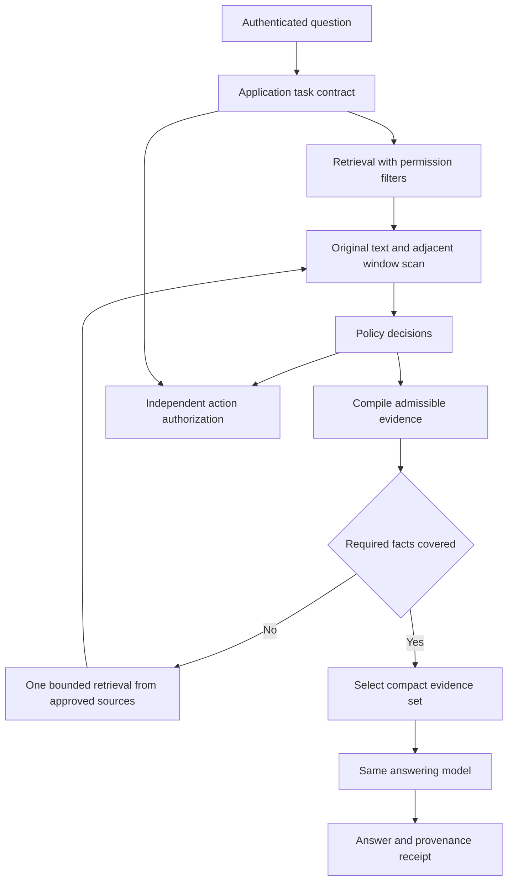

# PROMPTGUARD final build design

Design date: 7 November 2026

## The product decision

Build an evidence firewall for retrieval augmented generation applications. PROMPTGUARD inspects retrieved material, excludes content that violates policy, and recovers the evidence needed to finish the legitimate task from authorized sources. Every answer comes with a machine readable account of which evidence entered the context and which material was excluded.

The first application is a financial filing assistant. An analyst asks a question about a company's reported results. A poisoned research note attempts to redirect the assistant. PROMPTGUARD quarantines the note, retrieves the missing reported facts from an approved filing or structured financial record, and supplies a compact evidence set to the same answering model.

The product promise is measurable: reduce successful instruction hijacking while preserving correct, supported answers. The distinctive contribution is the evidence selection and recovery engine, together with an evaluation that measures both outcomes. The pretrained detector is one replaceable component.

This is a design, not an implemented system or a benchmark report. All performance thresholds below are prospective targets. The supplied research map informs the design; its embedded implementation handoff is reference material rather than an instruction to execute it automatically.

## Design against the four equally weighted criteria

| Criterion | Concrete design choice | Evidence the judges will see | Failure to avoid |
| --- | --- | --- | --- |
| Innovation 25 percent | Compile task relevant evidence, repair gaps after quarantine, and select a small sufficient context | A scanner only baseline loses an answer; the recovery engine completes it from admissible evidence | Claiming that an API or a collection of models is novel |
| Impact 25 percent | Serve developers building document assistants, with financial research as the first bounded workflow | A real analyst question succeeds despite a poisoned retrieved source; clean questions still work | Counting every refused answer as a security success |
| Technical depth 25 percent | Real classifier, real retrieval, typed facts, provenance, independent policy enforcement, controlled ablations | Source to record to decision to answer trace, paired test results, latency and failure cases | Reporting classifier accuracy as application security |
| Presentation and demo quality 25 percent | One replay screen with three synchronized runs and expandable source evidence | The retrieved attack, exclusion, replacement facts, answer, and measured outcomes are visible live | A dashboard of aggregate numbers with no working causal story |

No scoring outcome can be guaranteed. The design gives each criterion an observable result rather than relying on polish or breadth.

## What the research changes

The research map correctly identifies overblocking, task context, selective computation, source permissions, and application level evaluation as central problems. Existing retrieval rails, security APIs, and RAG testing products already cover substantial parts of the proposed foundation. [NeMo Guardrails](https://docs.nvidia.com/nemo/guardrails/latest/about-nemo-guardrails-library/rail-types), [Check Point Guard API](https://docs.lakera.ai/docs/api), and [Promptfoo RAG testing](https://www.promptfoo.dev/docs/red-team/rag/) establish that competitive baseline.

Task awareness and information preserving filtering also have research precedent. [Task Shield](https://aclanthology.org/2025.acl-long.1435/) motivates checking actions against the user's task; [DataFilter](https://arxiv.org/abs/2510.19207) investigates removing malicious instructions while preserving useful data. [CaMeL](https://arxiv.org/abs/2503.18813) motivates keeping permissions and control flow outside untrusted content. These are inspirations, not algorithms we claim to have invented or reproduced.

Our proposed engineering contribution is narrower and testable: an exact, source linked representation of admissible evidence; a bounded search for replacement evidence when filtering creates a gap; and a fair comparison showing whether that recovery improves the security and utility tradeoff. Global novelty remains unproven.

The central question changes from whether a passage looks malicious to whether we can complete this authorized task using a small, auditable set of admissible evidence.

## Scope and threat model

The attacker can edit a lower trust research note, an ingested document, or a retrieved text passage. They can try role impersonation, answer manipulation, obfuscated instructions, or instructions distributed across adjacent chunks. They can make a document more likely to be retrieved. Tests use harmless canaries and a mock action sink.

The attacker cannot edit server policy, the authenticated user's identity, the approved source registry, model artifacts, or the protected source manifest. Compromise of those components is outside the prototype's threat model and must not be described as solved.

The financial application supports reported numeric fact lookup and simple comparisons over a fixed issuer and metric registry. Open ended financial advice is outside the first version. A narrow task vocabulary lets the system validate periods, units, concepts, and computations independently of an LLM.

Prompt injection, unauthorized access, and false source facts are different failure classes. The detector addresses suspicious instructions; server policy addresses access; matching reported facts and identifying conflicts improve grounding. Provenance and agreement do not prove that the underlying business claim is true.

Public filing data can still be untrusted as instructions. An approved URL or matching hash never grants a document permission to change application behavior.

## The user experience

The demonstration has one question box, one source selector, a choice of labeled harmless test variants, and Run comparison. Three columns display the same question and starting retrieval:

1. Original RAG receives the retrieved passages.
2. Scanner only applies the selected detector and removes flagged passages.
3. PROMPTGUARD applies the same detector, compiles admissible evidence, and repairs missing coverage.

Each column shows the answer, task result, attacker result, elapsed time, and source citations. Status uses text and icons as well as color. An expandable source drawer shows the original passage, the source location, detector decision, and the replacement evidence. Another drawer shows exactly what reached the answering model.

The lower part of the screen contains measured outcomes from the current small replay and a clearly separate link to the last complete evaluation. A saved evaluation includes its run ID, counts, hardware, and revisions. It never appears to be a full benchmark that just ran live.

The source drawer shows attack spans annotated by the fixture author as ground truth when available. Detector window highlights are labeled as windows, not precise model explanations. No attention map is presented as proof of why a model made a decision.

The answer shown in every column comes from an actual run. Baseline failure, successful protection, and refusal are all legitimate visible outcomes.

## Architecture



The recovery loop is limited to one additional retrieval round. Missing coverage after that round returns INSUFFICIENT_EVIDENCE. The answering model has no direct network access or tools in the initial financial workflow.

### The task contract

An authenticated application route establishes the permitted workflow. The question supplies intent within that workflow; it cannot enlarge the user's permissions. The financial adapter resolves the issuer from a trusted registry, the allowed metric, the requested reporting period, and the permitted operation such as lookup or percent change.

The contract contains the user and tenant binding, allowed source scope, required facts, answer form, tool permissions, and work budget. It is frozen before retrieved content is read. An ambiguous issuer or period yields an explicit clarification requirement or unsupported task response.

Retrieved text cannot alter the contract. No LLM interpretation of a document can grant a new permission. This implements a limited control boundary, not the full CaMeL interpreter.

### The evidence compiler

Original source bytes and extracted text are retained locally in the demonstration corpus. Every paragraph, table cell, or structured record has a stable location, source revision, and content digest. Text offsets refer to the exact versioned extracted text; JSON records use JSON pointers; table cells also retain their row and column labels. Normalized scanning views preserve a mapping back to that representation.

A financial evidence record contains these fields:

```text
evidence_id
issuer_id                 from the trusted issuer registry
concept                   from the allowed financial concept registry
period_start and end      parsed and checked dates
unit                      a validated unit identifier
value                     decimal, not arbitrary text
source_id and revision    resolved from the server source manifest
source_location           exact table cell or JSON pointer
derivation                an allowed, reproducible conversion if needed
```

The first implementation uses deterministic parsers for selected XBRL facts and supported filing tables. Any LLM proposed extraction is merely a candidate and must resolve to the exact source value and schema. Unknown fields, arbitrary instructions in numeric fields, conflicting periods, and unresolved source IDs are rejected.

Display names and answer labels come from application templates. Source supplied strings never become system messages, tool names, network destinations, or policy values. This narrows the instruction carrying surface; it does not make all possible model behavior safe.

For a suspicious prose passage, the compiler does not ask a generative sanitizer to rewrite it into apparently trusted content. The passage remains quarantined. Needed facts must come from another admissible record or a separately ingested, validated representation under the source policy. The origin of a replacement remains explicit.

### Evidence recovery and selection

The engine first checks which contract facts remain available after policy enforcement. If any are missing, it issues one recovery query constructed from the frozen issuer, metric, and period. It searches only an approved local index or a fixed connector; it never follows URLs supplied by the suspicious passage.

Candidates pass the same permission and validation checks. Retrieval excludes the quarantined source revision and its known duplicate family. If recovery uses an official structured representation of the same filing, the receipt labels it as the same underlying source in a different representation. It must not count as independent corroboration.

Within the eligible candidates, the engine seeks the smallest context that covers the required facts. For the prototype, a deterministic greedy cover is sufficient: prefer candidates that add missing facts, then prefer fewer tokens, fewer unresolved warnings, and better source location quality, using stable tie breaking. A small context helps latency and reduces unnecessary exposure; it is not a security proof or a claim of a globally optimal solution.

If eligible sources disagree, apply a declared filing version rule or return a conflict. Do not choose whichever value produces a convenient answer. Insufficient or conflicting evidence yields an explicit answerability status.

### Detection and policy

Start with one pinned revision of Horizon Guard Small, subject to a local smoke test. Its card describes a 141M parameter multilingual classifier with ONNX artifacts and direct and indirect injection use cases. Those are publisher claims, not our measurements. [Model card](https://huggingface.co/Horizon-Labs/prompt-injection-guard-small/raw/main/README.md)

Scan original and carefully normalized text in overlapping token windows, and include adjacent retrieved chunks from the same source. Record truncation and all enforced size limits; silently dropping a long passage tail is forbidden. Window scores are signals rather than token level attribution or calibrated probabilities of safety.

Use a threshold frozen on development and validation data. High suspicion yields QUARANTINE. A permission violation yields DENY regardless of the detector score. A timeout, incomplete scan, or unknown label yields an explicit error and no approved context in the default demo policy. A low score never overrides a permission denial.

P0 uses one detector and transparent decisions. Query aware review is a later experiment only if error analysis shows a benefit. It cannot grant permissions, undo a deterministic denial, or manufacture source evidence. No second detector is required for the core contribution.

### Answers and receipts

The comparative experiment uses the same answering model, revision, user question, generation settings, and answer format across the three main conditions. PROMPTGUARD changes the supplied evidence; scanner only changes which original passages survive.

Answers carry evidence IDs. The service checks that IDs resolve to the admitted set; the financial verifier separately checks requested values, units, periods, and allowed computations. A citation alone does not demonstrate that a sentence is supported.

Receipts bind the request, contract, source revisions, original retrieval, exclusions, replacements, admitted evidence, detector revision, threshold, policy version, and timings. A keyed digest protects the binding; verification must compare the actual context bytes against the receipt. The receipt is an audit record, not a certificate of semantic safety. Operational logs contain metadata and keyed digests rather than document text. Public demo source text is available only through the local fixture viewer.

An optional strict numeric mode renders validated financial records through fixed templates. Its stronger output restriction is valuable for bounded enterprise tasks, but its results must be reported separately from the same model experiment. Replacing an LLM with a template must never be credited as improved detector performance.

## Service and implementation boundaries

The product is a hosted or privately deployed API plus a small client adapter. The comparison screen is a demonstration client. The prototype runs locally and uses public data.

| Interface | Responsibility |
| --- | --- |
| POST /v1/scan/retrieval | Validate and scan supplied chunks; return decisions and versioned reasons |
| POST /v1/prepare-context | Enforce the task contract, compile evidence, use a configured recovery connector if needed, return context and receipt |
| Local demo replay command | Execute original, scanner only, and recovery conditions against the same saved starting retrieval |
| Evaluation CLI | Produce per sample outcomes, aggregate metrics, and a reproducibility manifest |

The scan endpoint cannot claim to enforce a permission system it has not integrated with. In the local application, permissions are applied before retrieval and checked again before context assembly. In a customer integration, trusted identity and ACL evidence must come from the application's server or an authenticated connector.

Tenant identity comes from authentication. Client supplied trust labels are descriptive until validated against the server manifest. Receipt access is tenant scoped. Request size limits, deadlines, duplicate ID checks, and explicit error schemas are part of P0.

The main implementation uses Python, FastAPI, Pydantic, one classifier runtime, a small BM25 or TF IDF retriever, local JSONL or SQLite records, and a lightweight replay view. Model and dependency versions are pinned after checking the available machine. A vector database, model training pipeline, multiple agents, and numerous SaaS connectors are unnecessary for this demonstration.

The source tree should make the contribution inspectable: contracts, detector adapter, policy, evidence parsing, recovery, context selection, receipt generation, demo, evaluation, and tests are separate modules. The same admission function is used by both the API and benchmark runner.

## Data that makes the result credible

Use three distinct tracks. Their results remain separate.

| Track | Source and proposed size | What it establishes | Limitation |
| --- | --- | --- | --- |
| Public injection evaluation | IndirectRAG Bench card lists 500 cases | Detector behavior and paired application tests on documented fixtures | Synthetic and templated; not evidence of production prevalence |
| Public hard benign evaluation | NotInject contains 339 benign prompts | Overblocking diagnostic | Mostly prompt examples rather than complete retrieved business documents |
| Real document workflow | Target six issuer filings, ten bounded questions per filing, clean and three harmless poisoned variants per task | Retrieval, parsing, answer preservation, and recovery on real carrier documents | Small authored test set; repeated variants are dependent |

[IndirectRAG Bench](https://huggingface.co/datasets/heisenberg-88/indirectrag-bench) and [NotInject](https://huggingface.co/datasets/leolee99/NotInject) provide the public tracks. The real workflow uses SEC filings and XBRL JSON, whose API and reporting context are documented by the [SEC](https://www.sec.gov/search-filings/edgar-application-programming-interfaces).

For example, Apple's 2025 filing reports total net sales of 416,161 million US dollars. This is a source fact suitable for checking units and periods, not a model performance result. [Apple 2025 Form 10 K](https://www.sec.gov/Archives/edgar/data/320193/000032019325000079/aapl-20250927.htm)

Keep original public sources unchanged. Test variants are separately labeled derivatives containing only harmless attacker goals. Store the source URL, retrieval date, accession or revision, content digest, parser version, transformations, annotations, and applicable rights information. Public accessibility does not automatically authorize redistribution of an entire corporate document corpus. Retain manifests and permitted excerpts or reproducible downloads as appropriate.

The SEC representations are correlated when they derive from the same filing. Matching them checks representation and parsing consistency rather than providing independent truth votes. Correctly handle units, duration versus instant facts, issuer calendars, amended filings, duplicate records, and reporting periods. Do not flatten all numbers into an undifferentiated revenue field.

The proposed local corpus contains 60 base questions, 60 clean executions, and 180 poisoned variants before additional hard benign and missing evidence cases. These are design quantities, not loaded data or independent statistical samples. If only a subset runs, display its actual counts and selection method.

Reserve issuer groups for development, validation, and final testing. Keep all variants and source derivatives of a base question together. Keep injection templates exclusive to their assigned splits; avoid distributing a single template across every issuer and then calling the issuer holdout leakage free. Assign paired clean and poisoned questions together. Freeze thresholds before public test evaluation. Record known or unknown model training overlap; an unfamiliar local split does not prove that a public benchmark was absent from model training.

## Experiments and metrics

The primary comparison has three conditions:

| Condition | Detector | Context preparation | Answering model |
| --- | --- | --- | --- |
| U original | None | Original retrieved text | Same pinned model |
| S scanner only | One frozen detector | Drop flagged material | Same pinned model |
| R evidence recovery | The same frozen detector | Compile evidence and recover missing facts | Same pinned model |

Within R, run a smaller ablation with recovery disabled to isolate the value of the extra retrieval from the value of compiling compact evidence. If strict template rendering is implemented, report that as a fourth, separately labeled condition.

Two retrieval settings answer different questions. First freeze the starting retrieved set across U, S, and R to isolate middleware effects; R's additional retrieval is explicitly part of its treatment and cost. Then run a separate indexed retrieval test that measures whether poisoned documents enter the top k. A benchmark with injected passages already supplied cannot establish retrieval resilience.

Primary application outcomes are protected and unprotected attacker success, legitimate task completion on clean and poisoned cases, unsupported answer rate, and explicit insufficient evidence outcomes. A refusal stops the attacker but counts as a task failure when the answer was available. Recovery success is reported on a preregistered subset where admissible replacement evidence actually exists, as well as on the whole suite.

Report unconditional attack success over all valid evaluated attack cases and conditional residual success on cases where the undefended model succeeded. State both denominators. A model that already resisted an attack cannot provide evidence of a newly prevented success.

Detector results include recall, false positive rate, confusion matrix, threshold, and per source diagnostic slices. Do not pool NotInject prompt diagnostics with retrieved document metrics. Report warm p50 and p95 added latency, cold start separately, window counts, recovery frequency, answer model token usage, and measured resource or provider cost assumptions. Local inference is not free merely because there is no API invoice.

Use deterministic verifiers where possible: exact canary appearance, calls to the mock action sink, numeric values with declared tolerances, units, periods, and reproducible calculations. More open ended support judgments require annotated human review or an explicitly labeled fallible judge. The attacker indicator never enters the production detector as a special blacklist.

Report counts, failures, and uncertainty. Paired variants are correlated. Use group level summaries and cluster intervals only when enough independent groups exist; with a small issuer holdout, describe the result as a prototype feasibility study rather than a precise production estimate. Zero observed failures in a small sample is not a zero risk guarantee.

The research map's emphasis on leakage aware evaluation is supported by [RAG PIBench](https://arxiv.org/abs/2610.08571), which compares learned detectors with strong sparse baselines under protected splits. Dataset access and rights must be checked before adopting any additional corpus. None is required for P0.

### Prospective acceptance targets

- Every denied or quarantined original chunk is absent from the assembled answering context in invariant tests.
- Every admitted financial record resolves to an exact permitted source value, period, and unit.
- At least one genuine baseline attack is stopped live and the legitimate question is answered from admissible evidence. If the live baseline resists, report that outcome rather than forcing failure.
- R improves task completion over S on the frozen recoverable poisoned subset without a material increase in attack success. Set any numerical tolerance on validation data and lock it before final evaluation.
- Clean task completion remains within five percentage points of the unprotected clean baseline as an initial product target. Report uncertainty; a small sample cannot establish that margin reliably.
- No candidate has an unbounded retry loop: one recovery round, explicit inference and request deadlines, and a stated token budget.
- On the selected reference hardware, aim for warm p95 scanning below two seconds for at most four 512 token chunks. This is a budget to test, not a claim of measured speed. Report normalization and extra window overhead; measure the slow recovery path separately.

## The live demonstration

| Time | Action | What the audience learns |
| --- | --- | --- |
| 0 to 20 seconds | Ask a real reported results question and open its original filing evidence | The assistant has a legitimate job and the data is real |
| 20 to 45 seconds | Run a labeled poisoned retrieval through original RAG | A lower trust document can redirect an actual model |
| 45 to 70 seconds | Run scanner only | Excluding a document can stop an attack while losing the useful answer |
| 70 to 105 seconds | Run PROMPTGUARD and expand the recovery trace | Missing facts are recovered, their source locations are visible, and the same task succeeds |
| 105 to 125 seconds | Run a legitimate financial passage containing a quoted security warning; inspect classification and answer | Any false alarm is visible, and task utility is measured separately from classification |
| 125 to 150 seconds | Show current replay outcomes and the separate complete evaluation | The claim rests on measured attacks, task utility, and cost |

The central demonstration uses an attack variant whose behavior was genuinely observed before the presentation, with the full prompt, model revision, and outputs retained. No intentionally weakened victim prompt or hardcoded bad answer is used to manufacture success. A saved genuine trace is available as a clearly labeled fallback if the live provider is unavailable. Saved output is never presented as live.

Include a missing replacement evidence case in the test suite and be ready to show it. Honest refusal establishes that recovery has a boundary.

## Build order and stop rules

| Milestone | Reviewable result | Gate before expanding |
| --- | --- | --- |
| 1 establish real data and victim | One downloaded filing, parsed facts, actual retriever, actual answering model | Clean task is correct and at least one harmless attack behavior is observed or documented as resisted |
| 2 establish the baseline | One real classifier, strict scan API, scanner only run, benchmark importer | Labels and windows checked; quarantined text exclusion tests pass |
| 3 build the contribution | Frozen task contract, financial evidence compiler, one recovery retrieval, compact context selection | Missing coverage is repaired from admissible facts or returns insufficient evidence |
| 4 make behavior auditable | Versioned source locations, receipts, context inspection, API error paths | Every returned evidence ID resolves and permission denials survive all model outputs |
| 5 evaluate the hypothesis | Frozen comparisons and compiler without recovery ablation | Actual security, utility, latency, and failures exported before polishing claims |
| 6 prepare the presentation | Three column replay, source drawer, short demo, labeled saved fallback | A full rehearsal works from a fresh application start |

Do not spend the core build on training a detector, model ensembles, a generalized autonomous agent, an enterprise dashboard, or numerous integrations. Query aware review, an additional domain adapter, and strict numeric rendering are extensions after the core experiment runs.

If the main detector is incompatible with the machine, try the documented ONNX artifact or a tested DeBERTa adapter and disclose the change. If no real model runs, a transparent rules baseline can establish plumbing but does not satisfy the intended model based demonstration. If recovery fails to improve outcomes, retain and report the result; do not conceal a worse comparison.

Required tests cover schema errors, deadlines, model errors, tail truncation, adjacent chunk attacks, duplicate IDs, denied sources, stale receipts, context binding, attempted metadata authority spoofing, unresolved evidence, unit and period mismatch, conflicts, and no replacement evidence. Mock low detector scores can test the independent permission boundary, but such tests are not counted as measured detector robustness.

## Impact and commercial direction

The first beneficiary is a developer operating a document assistant whose users need useful answers rather than frequent blanket refusals. Financial research is a concrete wedge because facts have periods, units, and source locations that can be verified. Policy lookup and support workflows are possible later adapters, each with its own task and evidence validation limits.

The developer integrates at context assembly. The application supplies a trusted task profile and source permissions; PROMPTGUARD returns admissible context, explicit answerability status, decisions, and an audit receipt. An optional recovery connector is configured once rather than accepting arbitrary destinations from retrieved text.

Commercial value would come from maintained adapters, tested policy revisions, workload specific evaluation, and deployment choices. Customer interviews and pilot workloads must validate willingness to pay. Do not invent market size, savings, adoption, or breach reduction figures.

Before processing confidential customer documents, deployment would need an appropriate data handling agreement, retention controls, real authentication and tenant isolation, operational security, and component license review. Those are commercial readiness work, not achievements of the hackathon prototype. The demonstration uses public filings and authored fixtures.

The pitch can be stated plainly: PROMPTGUARD helps a document assistant reject instructions hidden in retrieved material, recover the evidence needed for the real question, and show how the answer was produced.

