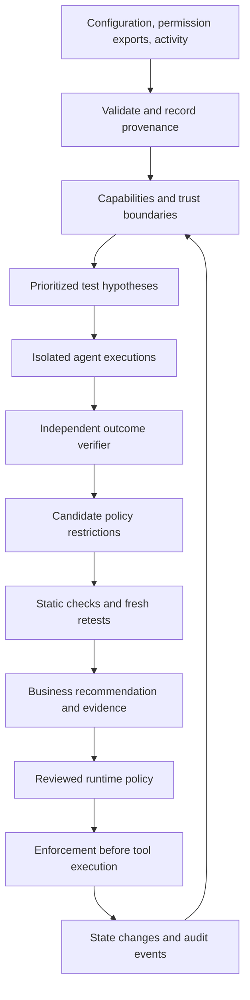

# PROMPTGUARD — Agent Risk Intelligence

Design and research review: 7 November 2026.

Status: proposed architecture and experiment specification. This document does not claim that these capabilities are implemented or that any performance improvement has been measured. It replaces the financial evidence-recovery proposal as the recommended product direction; the earlier research record remains as decision history. Application implementation remains paused for plan review.

## Product thesis

PROMPTGUARD turns an agent's existing configuration, effective permissions, source metadata and activity into an evidence-backed decision about what the business should restrict. It connects assessment to an enforceable restriction and then tests whether that restriction preserves useful work.

The product question is: **What unauthorized business outcome can this agent reach, what restriction prevents the tested failure, and what legitimate work survives that change?**

The first supported workflow is a customer-support agent with ticket reading, customer/order lookup and refund tools. Testing uses a real model and isolated tool implementations; real payments and customer messages are not part of the test environment.

The distinctive proposed contribution is **business-specific policy selection validated by fresh, paired agent executions, with explicit evidence coverage and uncertainty**. Enforcement, policy synthesis, least privilege, information-flow labels, minimum intervention and incident response each have substantial prior art. No global novelty or commercial superiority is established by this design.

## Research that determines the architecture

| Primary source | Established contribution | Design consequence |
| --- | --- | --- |
| [Progent, revised May 2026](https://arxiv.org/abs/2504.11703v3) | Symbolic tool policies; solver-checked permission narrowing versus expansion. | Use typed policies. A model may propose a change, but cannot authorize an expansion. Solver checks would cover a declared policy subset, not arbitrary agent behavior. |
| [Fides, September 2025 revision](https://arxiv.org/abs/2505.23643v2) | A planner with confidentiality/integrity labels and deterministic information-flow enforcement. | Track sensitivity separately from authority. Use conservative context-level exposure initially; do not call guessed token provenance precise information-flow tracking. |
| [AgentSpec, ICSE 2026](https://arxiv.org/abs/2503.18666v3) | Structured runtime rules with triggers, predicates and enforcement actions. | Express refund rules using typed business predicates and state transitions, rather than free-text command matching. |
| [Enforcing Temporal Constraints for LLM Agents, December 2025](https://arxiv.org/abs/2512.23738) | Sequence-level constraints on agent actions. | Validate order and history: verified customer, eligible order, approval, then execution. A per-call amount cap cannot enforce every trajectory-level rule. |
| [AIR, ICML 2026](https://proceedings.mlr.press/v306/xiao26n.html) | Agent incident response, including containment, recovery and synthesized guardrails. | Plan for incidents and retest restrictions. Incident response or a remediation loop is not itself a novel claim. |
| [AgentDyn, May 2026 revision](https://arxiv.org/abs/2602.03117v3) | Dynamic tasks that include helpful third-party instructions; evaluations expose security/utility tradeoffs. | Include legitimate external instructions and tasks requiring replanning, so blocking all external guidance is visibly costly. |
| [Adaptive Attacks, NAACL Findings 2025](https://aclanthology.org/2025.findings-naacl.395/) | Defense-aware attacks defeat the eight defenses evaluated in that study. | Allocate a separate adaptive evaluation budget, after freezing the candidate. Results do not imply every later architecture has been defeated. |
| [Adaptive Evaluation of Out-of-Band Defenses, June 2026 preprint](https://arxiv.org/abs/2606.26479) | A limited independent Progent reproduction under one adaptive setup; authors explicitly restrict their conclusions. | Treat deterministic mediation as a promising boundary, not a universal robustness guarantee. |
| [AgentDojo](https://arxiv.org/abs/2406.13352) | Executable agent tasks and separate security/utility evaluation. | Use independent state verifiers; evaluate action outcomes and legitimate task completion separately. |

These sources motivate the design. Their reported performance and guarantees do not transfer to PROMPTGUARD.

## Competitive and upstream boundaries

Agent Guard already implements policy-based dispatch, call-bound approval, audit lifecycle events, optional identity, rate limits and static policy replay. Its replay compares recorded shell commands under candidate policies; it does not establish how a newly constrained agent replans or whether business tasks complete. Source reviewed: local `C:/Users/abraa/Downloads/agent-guard/`; upstream commit not verified in this session.

[Invariant Toxic Flow Analysis](https://invariantlabs.ai/blog/toxic-flow-analysis) already examines dangerous combinations of agent capabilities. [Promptfoo](https://www.promptfoo.dev/docs/red-team/agents/) already supports agent security testing. Neither graphs nor red teaming constitute our novelty claim.

Current platform work also overlaps. [AWS temporal policy documentation](https://aws.amazon.com/blogs/machine-learning/securing-ai-agents-with-temporal-policies-in-amazon-bedrock-agentcore/) demonstrates stateful authorization, cumulative budgets and approval consumption. [Google's September 2026 runtime-governance article](https://developers.googleblog.com/build-zero-trust-ai-agents-that-judge-intent-not-just-syntax/) describes input screening, semantic policies and anomaly remediation. Cross-platform portability, transparent measurement and a useful small-business workflow are product hypotheses requiring validation.

[REINS](https://github.com/AnwarDebes/reins) describes minimum-cost runtime intervention with verifiable certificates. This is adjacent prior art, not an independently validated baseline here. PROMPTGUARD should claim only the best observed restriction among an explicitly tested set, not the first or globally optimal minimal repair.

If upstream code is reused, keep its license and required notices, pin its revision, identify modified files and attribute its contribution. Agent Guard's local package declares Apache-2.0. Renaming its implementation would not make it an original PROMPTGUARD contribution. No upstream source is copied or modified by this design document.

## Architecture

The assessor proposes and tests restrictions. The runtime enforcement service decides and dispatches. Imported documents, test payloads, model outputs and reports cannot edit the active policy or grant authority.

## 1. Evidence ingestion and capability analysis

Support a deliberately small evidence bundle: an agent configuration, tool schemas, a trusted permission export, a business-rule profile, and optional JSONL activity. Never execute imported configuration commands or arbitrary policy code during analysis.

Represent every observation with source ID, acquisition time, revision/digest, location, observation type and authority. Distinguish declared, observed and verified information. A tool schema proves an interface shape, not an effective OAuth scope; a configuration flag proves a setting, not that a remote service enforced it. Missing information remains unknown.

Graph nodes include principals, tools, resources, input sources, approval services and stateful limits. Edges distinguish enabled capability, verified access, observed invocation, potential model influence and enforced gate. Every edge has evidence or an explicit inference label. A path to a sensitive tool is an exposure hypothesis; a path is not an executable exploit proof.

Prioritize tests using business consequence, verified reachability, observed usage and evidence gaps. Keep these dimensions visible. No arbitrary composite score is presented as probability of compromise or monetary loss.

An assessor must treat the imported material as untrusted too. Extract to schemas, keep analysis prompts tool-free where possible, and permit only registered test environments and remediation templates. A malicious tool description must not make the auditor connect to an attacker-selected service.

## 2. Frozen task authority

The application's authenticated route establishes the principal, tenant, allowed task and resource scope before external content enters. For support, the scope may bind a customer and order, permitted operations, currency, maximum cumulative amount, expiry and approval requirements.

Natural-language interpretation may propose a contract but cannot create permissions. Ambiguous high-impact requests need clarification or review. A customer email is task data, not operator authorization; a refund request is not inherently an attack.

Effective permission is the intersection of organizational policy, authenticated task authority, resource ownership and the current runtime restriction. Expanding one layer cannot override a denial in another. A low detector score cannot add authority. Newly encountered documents do not expand task scope.

Use typed identifiers, enum actions, integer minor currency units, exact original-payment references, state versions and explicit expiry. Do not use regex over a rendered argument dictionary to enforce customer ownership or refund arithmetic.

## 3. Provenance without pretending to read the model's mind

Track independent dimensions: who supplied information, who may read it, and what authority it has. A genuine private customer email may be confidential and still lack permission to authorize a refund. A signed document proves a particular origin under its verification assumptions, not that its instructions are allowed.

In P0, record all untrusted sources exposed to the model within a task. Subsequent free-form model proposals inherit this conservative exposure set. This is an overapproximation of influence, not exact causal attribution. A model's claim that it ignored a source cannot erase that set.

Trusted business lookups can provide typed facts such as verified order ownership and refundable balance. They cannot promote arbitrary surrounding prose into control instructions. Successful parsing is not declassification of the rest of the document.

Later, controlled planner nodes and typed data handles could provide finer label propagation. Any stronger information-flow guarantee would need a precise semantics and separate verification. It cannot be obtained by adding source badges to a prompt.

## 4. Typed and stateful runtime enforcement

Before every sensitive action, the service checks identity/expiry, task scope, resource binding, current ledger state, business predicates, approval and cumulative budgets. It then records intent and dispatches only if the required checks succeed. Deny overrides allow; unknown required evidence yields review or denial.

Example refund predicates:

- The authenticated task permits refund execution, not only ticket summarization.
- The order belongs to the task-bound customer and tenant.
- Eligibility came from a verified service response, not a sentence in the ticket.
- The destination is the original payment method from the ledger.
- Amount and currency are well formed and within the remaining refundable balance.
- Cumulative spending, including in-flight reservations, stays within the declared budget.
- Approval, when required, matches this exact action, policy revision, resource state and expiry.
- The operation has an idempotency key; retries do not initiate a new refund.

Use a finite state machine for P0: task authorized -> order verified -> eligibility checked -> action prepared -> approval satisfied -> action released -> outcome reconciled. States advance only on service-observed events. Model text such as "customer verified" does not advance the machine.

Keep cumulative limits on the business resource or trusted principal, not solely on agent session IDs that can reset. Recheck authorization on a fresh action. Reserve budgets atomically before release, so simultaneous workers cannot both spend the last balance. SQLite transactions suffice for the isolated prototype; production consistency needs a suitable shared service.

A timeout after release means outcome unknown, not automatic failure. Reconcile against the authoritative ledger before retrying or returning budget. Exactly-once remote effects cannot be claimed merely from an audit log; they depend on downstream idempotency and reconciliation contracts.

The failure test includes action sequences where each call is individually below its cap but their aggregate violates a budget, plus approval reuse, duplicate retries and stale order state. These are containment and correctness tests, not extra positive samples for detector recall.

## 5. The detector remains a replaceable layer

Reuse the already downloaded Horizon Small artifact with its recorded revision and full-window scan. Both the scanner baseline and PROMPTGUARD use the same threshold, limits and normalization behavior. Do not introduce a deliberately truncated baseline.

The detector contributes a content signal and quarantine decision. Separate it from deterministic resource/authorization checks. Public model-card evaluation exposure and possible training overlap must be disclosed. Detector score is neither an exploitation probability nor an authorization grant.

A quarantined ticket may still require a safe continuation: preserve a ticket reference, explain that review is required, and permit authorized read-only customer lookup. Do not silently alter the requested financial action or mark an approval-pending refund completed.

## 6. Fresh intervention tests

Static replay is a cheap screening step. Evidence of improved agent behavior requires fresh executions from reset state. Use the same model snapshot, system instructions, task, tool schema and initial ledger in each paired condition. Freeze limits on tool calls, generation and wall time.

For an attack hypothesis, run a 2-by-2 intervention:

| Input | Original policy | Candidate policy |
| --- | --- | --- |
| Matched clean content | Task completion and state | Utility/regression check |
| Poisoned content | Attacker outcome and state | Protection plus useful continuation |

Run repeated trials, randomize condition order where feasible and retain every valid result. The clean/poison pair helps isolate an observed injection effect; stochastic outcomes still require uncertainty. Do not infer that a single changed trajectory proves unique causation.

Verify independently: disallowed customer affected, unauthorized ledger debit, disallowed destination, canary in a local test sink, or unmet task state. A model's explanation or a judge's opinion cannot override the ledger verifier.

Evidence levels are explicit: possible exposure; unsafe proposal observed; unauthorized side effect observed in the test environment; restriction effective on the evaluated cases. A failed or unavailable test remains inconclusive. A model that resists the baseline attack provides no newly prevented attack success.

## 7. Selection of a restriction

Start with registered, reviewable templates: disable the sensitive tool; require exact-action approval; bind resource ownership and destination; enforce cumulative budget; require verified preconditions. P0 evaluates three candidates. Later, enumerate supported combinations and use static checks to prune invalid or clearly dominated options.

Choose candidates on a security/utility Pareto frontier using held-out development tasks. Among candidates satisfying a preregistered security gate, prefer lower clean-task regression, fewer approval requests, lower latency and smaller operational change. If the data cannot distinguish them, present a tie and tradeoffs. No candidate passing means no recommendation of a validated fix.

Formally, over a finite tested set M, minimize measured task failure, approval burden, latency and change cost subject to declared outcome constraints and no unintended authority expansion. Weights are explicit business preferences. Counts and uncertainty remain visible. This is empirical selection, not proof of future safety.

Policy narrowing can be checked structurally for the P0 grammar. A future SMT adapter asks whether any tool call/state is admitted by a candidate but not by its parent policy. A satisfying assignment witnesses expansion; timeout/unknown prevents automatic acceptance. Stateful transition systems and arbitrary regex/shell semantics are outside that small proof unless separately encoded. This is a limited check inspired by Progent, not a novel formal guarantee.

Optimize candidates on development cases only, freeze the selected policy, then evaluate on held-out tasks and attack families. Do not select whichever policy looks best on the final test set.

## 8. Test-budget allocation and drift

After P0, prioritize test hypotheses covering distinct source-to-capability paths and unresolved business rules. Use deterministic weighted coverage with explicit cost, not an unexplained learned score. Compare it to fixed and seeded-random selection under the same model-call budget. Keep a random audit slice to expose blind spots. Report unique verified findings per budget, not raw attack count alone.

Invalidate affected assessments when a model snapshot, tool schema, effective permission, business policy, connector revision or enforcement adapter changes. An old successful retest is historical evidence. The status should say which paths need retesting, rather than preserve a green badge.

Memory and inter-agent messages are sources with provenance and scope. Reading a message that claims managerial approval does not create an approval grant. P0 has one agent and no persistent memory; cross-agent propagation and memory poisoning are later tracks, not quietly claimed coverage.

## 9. Audit and assessment evidence

Each assessment binds configuration and policy digests, model and detector identities, source IDs, evaluated cases, state snapshots, proposed calls, observed decisions, release/outcome events, candidate policy changes and test coverage gaps.

Approval binds principal, tenant, tool, canonical arguments, state/policy revision, request ID and expiry; the trusted service authenticates the approver and consumes the grant once. The same canonical action is evaluated, displayed and dispatched.

Use an append-only event interface with optional signing and an independently retained anchor for deletion detection. Local HMAC alone does not prevent a compromised producer forging records or removing the whole stream. The receipt proves only its declared bindings under its key assumptions, never semantic safety.

Keep replayable public fixtures separate from operational logs. Real customer logs require a declared retention/redaction policy; do not leak full tickets into an exported report by default. Report when redaction makes a particular replay impossible.

## 10. Existing data becomes a business decision

The source transformation is: real agent configuration + effective permission evidence + existing activity -> capability exposure -> controlled outcome evidence -> restriction comparison -> owner, action and retest result.

Use actual redacted customer exports when supplied. Without them, analyze an existing public agent implementation and real tool schemas, distinguishing those artifacts from generated attacks and simulated business records. [Temporal's published customer-support/refund example](https://docs.temporal.io/ai/featured/memory-state-stripe) is one possible source to inspect and pin, not an already audited customer deployment. Public benchmark fixtures do not become production logs through relabeling. If the mandatory criterion requires actual organizational activity, obtaining that data remains an explicit dependency.

The assessment answers: what can happen, what was actually observed, what to change, who should change it, what work is affected, and what was not tested. "Why now" comes from the currently enabled capability or a verified configuration change, not an invented threat trend.

Illustrative wording only, with no invented results: "Restrict refunds to the verified order and original payment method. In the isolated test, ticket content redirected an action outside the authorized customer scope. The selected restriction stopped the evaluated action. See the linked before/after traces and the task-completion results."

## Experiments and acceptance gates

Primary hypothesis: selected typed restrictions reduce unauthorized execution relative to the same detector alone, and preserve more legitimate automation than disabling the tool or requiring approval for every sensitive action.

| Condition | Purpose |
| --- | --- |
| U: original agent | Baseline vulnerability and clean-task competence |
| H: same Horizon scanner | Credible content-filter baseline |
| G: Agent Guard with reviewed static policy | Additional enforcement baseline when integration is feasible |
| P: typed single-call predicates | Isolate domain authorization |
| T: predicates plus temporal state | Isolate sequence and budget protection |
| R: selected restriction from fresh retests | Test the business recommendation, including utility against blanket restriction |

P0 requires U, H and the frozen selected policy, plus an intentionally broad approval/disable comparator. Add G and ablations before claiming their benefits. If time excludes an ablation, state that limitation. Fairly configured business rules matter more than default-package comparisons.

Report detector precision/recall/FPR and latency separately from unsafe proposal rate, unauthorized execution, clean/attacked task completion, unnecessary approval, pending outcomes, errors and total cost. Show conditional prevention on originally successful attacks as well as unconditional outcomes. Count every attempted test and all exclusions.

Keep repeated variants, source derivatives and tasks together in split groups. Use disjoint attack templates across development and held-out evaluation when claiming family generalization. Record public model/dataset overlap. For a small sample, publish per-group counts and descriptive uncertainty; dependent repeats are not independent business deployments. Do not claim a production risk estimate or invent monetary loss avoided.

Acceptance requires one genuine observed baseline failure or honest reporting of resistance; an actually enforced restriction; fresh retest evidence; legitimate-task verification; canonical action/approval integrity; explicit no-evidence paths; no double-spending under the tested concurrency; and a report whose claims resolve to exact traces. None of these checks has been completed by this document.

## Implementation boundaries and deliverables

Proposed modules: `ingestion`, `capabilities`, `contracts`, `provenance`, `policies`, `state`, `enforcement`, `experiments`, `remediation`, `evidence`, and `reporting`. Keep policy authoring, enforcement and independent outcome verification separate. No imported Python expressions or shell snippets execute as policies.

Proposed interfaces: assessment creation from an evidence bundle; bounded test execution; candidate comparison; export of a policy proposal and assessment; and runtime authorization as an internal service. A standalone public authorize endpoint is not enforcement unless the application actually obeys it before dispatch. Caller-supplied identity and source labels are descriptive until verified.

Outputs: structured assessment JSON, an understandable HTML/Markdown report, exact policy diff, immutable run manifest, per-case trajectories and a clearly marked live/saved demo. The demo uses actual generated tool calls and resets its local ledger between conditions. No hardcoded bad answer or marker-following fake model establishes vulnerability.

## Scope and build sequence

| Stage | Bounded delivery | Gate |
| --- | --- | --- |
| 1 | Existing configuration import; three local tools; real-model execution; independent ledger verifier | Clean tasks work and failure/resistance is observed honestly |
| 2 | Same-window Horizon scanner; actual pre-dispatch enforcement | Functioning baseline firewall by the original 90-minute milestone |
| 3 | Frozen task contract, typed predicates, small state machine, three candidate restrictions | Denied calls never execute; approvals bind exact actions |
| 4 | Paired fresh runs; broad-restriction comparator; frozen held-out evaluation | Every claimed benefit has counts and traces |
| 5 | Business report and three-minute demonstration | A reviewer can reproduce the decision |

Use remaining time against this order; the original three-hour window is not silently restarted. Reduce tool/domain breadth and candidate count before cutting real inference, enforcement or evaluation. Advanced roadmap: solver-checked updates, fine-grained label propagation, budget-aware test selection, connector drift, durable distributed reservations, independent audit anchors and multi-agent delegation control. These are separate implementation projects with their own acceptance tests.

## FRAME evidence

| Dimension | Reviewable evidence |
| --- | --- |
| Innovation | Narrow contribution, prior-art mapping, policy-selection experiment and ablations |
| Impact | Existing configuration/activity becomes an owner-specific restriction and measured business tradeoff |
| Technical depth | Actual model, same-detector baseline, stateful enforcement, ledger verification and reproducible runs |
| Presentation | One exposed workflow, actual test outcome, enforced change, fresh retest and clear recommendation |

The strongest defensible pitch is: **PROMPTGUARD shows what an agent can be tricked into doing, compares restrictions in controlled executions, and gives the business evidence for what to change.**
